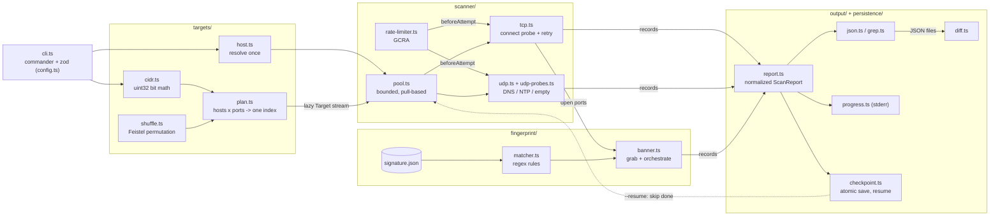

# port-sentinel

A TypeScript/Node.js CLI that finds open TCP and UDP ports on a host or IPv4 CIDR range,
identifies services from their banners using a data-driven signature file, and produces
JSON/greppable reports you can resume and diff over time.

Built as a learning project in security engineering. Each stage was specified before it was
coded, measured, and deliberately broken; the reasoning is recorded in [DECISIONS.md](DECISIONS.md).

> **Legal and ethical use.** Only scan systems you own or have **written permission** to test.
> Unauthorized scanning can violate computer-misuse laws and acceptable-use policies. Never scan
> a workplace network without explicit written approval. For practice, use local Docker labs
> such as OWASP Juice Shop or DVWA. CIDR scans print an authorization reminder and refuse blocks
> larger than `--max-hosts` (default 4096).

## Features

- **TCP connect scan** with open / closed / filtered / error classification from socket outcomes
- **Concurrency pool** with backpressure, a GCRA rate limiter, and retries on silence
- **IPv4 CIDR expansion** using bit math, scanned in a seeded pseudo-random order (Feistel permutation, O(1) memory)
- **Service fingerprinting** (`--banner`): NULL probe plus port-scoped send-probes, matched against regexes in [`signature.json`](src/fingerprint/signature.json)
- **UDP probes** (`--udp`): protocol-correct DNS and NTP payloads with reply validation, and the `open|filtered` state
- **Reports**: text, JSON, or tab-separated greppable output
- **Resumable scans**: atomic checkpoints, flushed on Ctrl-C
- **Diff** two JSON reports to see which ports appeared, disappeared, or changed

## Quick start

Requires Node.js 20 or later.

```sh
npm install
npm run dev -- scan 127.0.0.1 -p 1-1024          # run from source with tsx
npm run build && node dist/cli.js scan 127.0.0.1  # or build and run the compiled CLI
```

## Usage

```sh
# Single host, common ports, show every state
npm run dev -- scan 127.0.0.1 -p 22,80,443,8000-8100 -a

# Identify services on open TCP ports
npm run dev -- scan 127.0.0.1 -p 22,80,3000 --banner

# A small CIDR block, reproducible randomized order, 200 probes/s
npm run dev -- scan 192.168.56.0/28 -p 22,80 --seed 42 -r 200

# UDP: DNS on 53, NTP on 123
npm run dev -- scan 127.0.0.1 --udp -p 53,123

# JSON report to a file, checkpointing as it goes (Ctrl-C saves progress)
npm run dev -- scan 192.168.56.0/24 -p 1-1024 -o json --out-file today.json --checkpoint scan.cp.json

# Pick up an interrupted scan
npm run dev -- scan 192.168.56.0/24 -p 1-1024 --resume scan.cp.json

# What changed since the last scan? Exit code 1 if anything did.
npm run dev -- diff yesterday.json today.json
```

Practising against a local lab:

```sh
docker run --rm -p 3000:3000 bkimminich/juice-shop
npm run dev -- scan 127.0.0.1 -p 3000 --banner
```

### `scan` options

| Option | Default | Meaning |
|---|---|---|
| `-p, --ports <spec>` | `1-1024` | ports, e.g. `22,80,8000-8100` |
| `-t, --timeout <ms>` | `1000` | per-attempt deadline |
| `-c, --concurrency <n>` | `500` | max probes in flight (1–10,000) |
| `-r, --rate <pps>` | unlimited | max attempts per second |
| `--retries <n>` | `1` | extra attempts for ports that stayed silent |
| `-a, --all` | off | also list non-open ports |
| `--banner` | off | fingerprint open TCP ports after the scan |
| `--udp` | off | scan UDP instead of TCP |
| `--seq` / `--seed <n>` | randomized | CIDR order: ascending, or a reproducible shuffle |
| `--max-hosts <n>` | `4096` | refuse larger CIDR blocks |
| `-o, --output <fmt>` | `text` | `text`, `json`, or `grep` |
| `--out-file <path>` | stdout | write the report to a file |
| `--progress` | TTY only | force the stderr progress meter |
| `--checkpoint <path>` / `--resume <path>` | off | save progress / resume from it |

`diff <before.json> <after.json>` prints `+` appeared, `-` disappeared, `~` changed, and exits 1
when there are changes. That makes it usable as a scheduled monitoring check.

## Port states

| State | TCP | UDP |
|---|---|---|
| `open` | handshake completed (SYN/ACK) | a reply came back |
| `closed` | RST (`ECONNREFUSED`) | ICMP port unreachable (Linux only, see below) |
| `filtered` | no answer, or ICMP host/net unreachable | ICMP host/net unreachable |
| `open\|filtered` | n/a | silence: an open service ignoring us, or a firewall dropping us |
| `error` | local failure (e.g. `EMFILE`, `EACCES`); says nothing about the target | same |

## Architecture



**Data flow.** The CLI validates options with zod and turns the target into a *lazy* stream of
`(host, port)` targets: a single host's ports, or a CIDR plan that flattens hosts × ports into one
index range and shuffles it. The pool pulls targets only as slots free up, so memory stays
bounded even for a /8. Each worker waits on the rate limiter, then probes over TCP (`connect`)
or UDP (`dgram`). Results stream out in completion order and are normalized into
`ScanResultRecord`s, which feed the progress meter and the checkpoint writer. With `--banner`,
open TCP ports get a second fingerprinting pass. The final `ScanReport` is printed as text or
written as JSON/grep, and two JSON reports can be compared with `diff`.

| Module | Responsibility |
|---|---|
| [`src/cli.ts`](src/cli.ts) | commands, the scan pipeline, stdout/stderr discipline, SIGINT handling |
| [`src/config.ts`](src/config.ts) | port-spec parser and the zod schema for CLI options |
| [`src/targets/`](src/targets/) | hostname resolution, IPv4 CIDR math, Feistel shuffle, scan plan |
| [`src/scanner/`](src/scanner/) | concurrency pool, rate limiter, TCP and UDP probes |
| [`src/fingerprint/`](src/fingerprint/) | banner grabbing, signature compilation and matching |
| [`src/output/`](src/output/) | report model, JSON/grep formatters, progress, diff |
| [`src/persistence/`](src/persistence/) | checkpoints and resume |

## Design highlights

A few choices worth knowing about (full reasoning in [DECISIONS.md](DECISIONS.md)):

- **Own wall-clock deadline**, not `socket.setTimeout()` (an idle timer). Every probe settles exactly once and always destroys its socket.
- **Local errors are `error`, not `filtered`.** `EACCES` on Windows port 137 is our OS's policy, not a firewall on the target.
- **The pool applies backpressure.** Finished-but-unconsumed results hold slots, so a slow consumer stops new work.
- **Too much concurrency breaks results.** At 5,000 in flight, closed loopback ports were misreported as filtered because probes queued on our own machine for ~0.9 s (Little's law). See [BENCHMARKS](docs/BENCHMARKS.md).
- **Resume by membership.** Checkpoints record which `host:port` are done, so resuming is correct regardless of completion order or seed.
- **Signatures are data.** A new service is a JSON edit; every bundled pattern is anchored to limit regex backtracking.

## Platform notes

- **Windows can't detect closed UDP ports.** libuv ignores `WSAECONNRESET` on UDP receive, so ICMP port-unreachable never reaches JavaScript and closed ports read `open|filtered`. Linux reports `closed`.
- **Docker Desktop containers aren't routable from the Windows host.** Scan their published ports on `127.0.0.1`, or run the scanner in a container on the same Docker network.
- Line endings are forced to LF (`.gitattributes`) so the CLI's `#!/usr/bin/env node` line works in Linux containers.

## Development

```sh
npm run typecheck      # tsc over src, tests and bench
npm test               # vitest
npm run test:coverage  # vitest with V8 coverage
npx tsx bench/concurrency.ts   # concurrency benchmark (loopback + TEST-NET-1 only)
```

Tests use real loopback servers (TCP and UDP), the RFC 5737 TEST-NET-1 address as a "filtered"
target, fake clocks for timing logic, and fast-check property tests. Results are in
[docs/TEST_REPORT.md](docs/TEST_REPORT.md).

## Documentation

| Document | Contents |
|---|---|
| [docs/SPEC.md](docs/SPEC.md) | per-stage specification, written before the code |
| [DECISIONS.md](DECISIONS.md) | trade-offs, bugs found, and why |
| [THREAT_MODEL.md](THREAT_MODEL.md) | assets, attackers, abuse cases, mitigations, known gaps |
| [docs/BENCHMARKS.md](docs/BENCHMARKS.md) | measured behaviour and performance per stage |
| [docs/TEST_REPORT.md](docs/TEST_REPORT.md) | test inventory, coverage, and platform caveats |

## Project stages

- [x] 1. TCP connect scan of one host
- [x] 2. Concurrency pool, rate limit, retries
- [x] 3. CIDR parsing with bit math, randomized order
- [x] 4. Banner grabbing and a data-driven signature file
- [x] 5. UDP probes for DNS and NTP
- [x] 6. Output formats, progress, resumable scans, diff
- [ ] 7. Study write-up: how Nmap's SYN scan differs and why Node can't do it

## License

ISC
